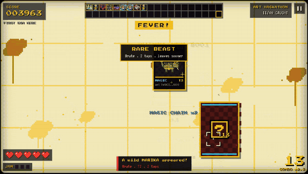
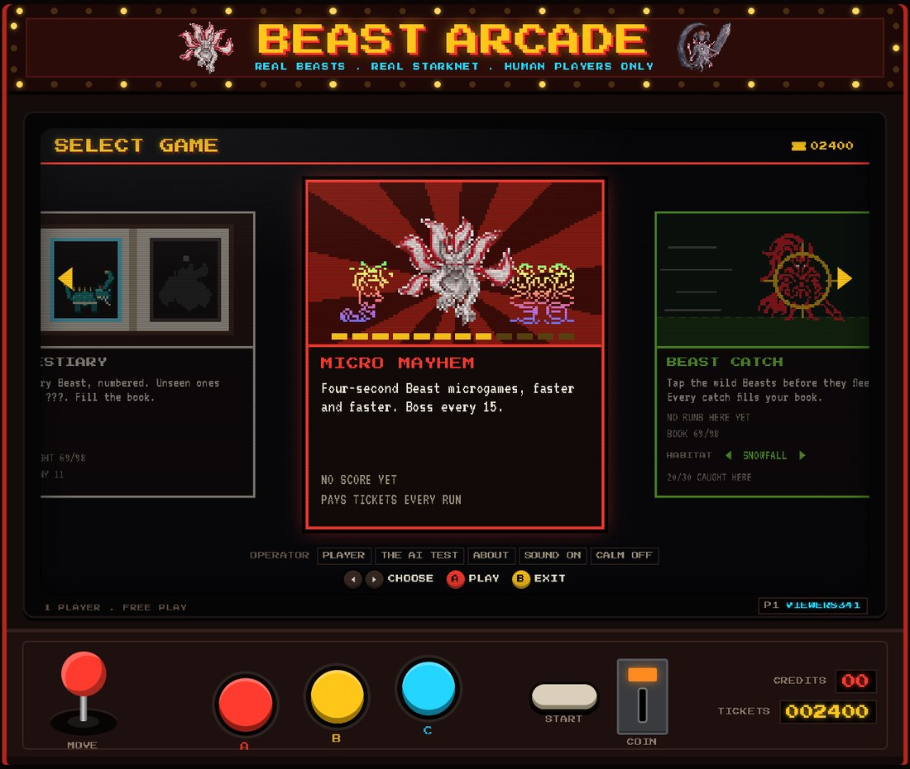
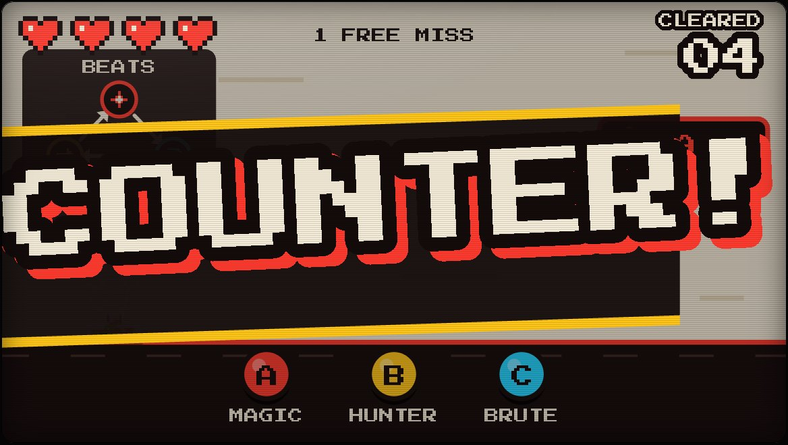
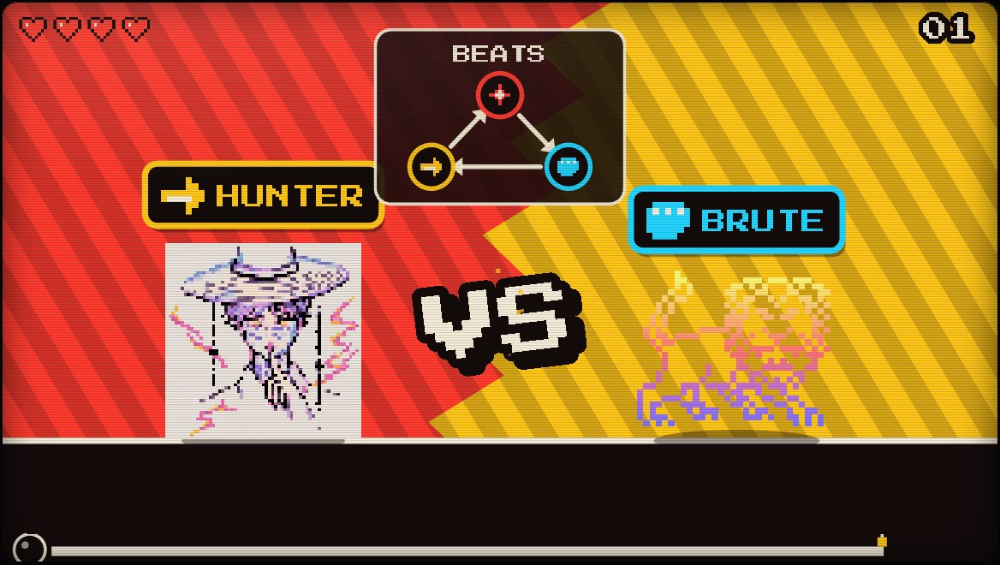
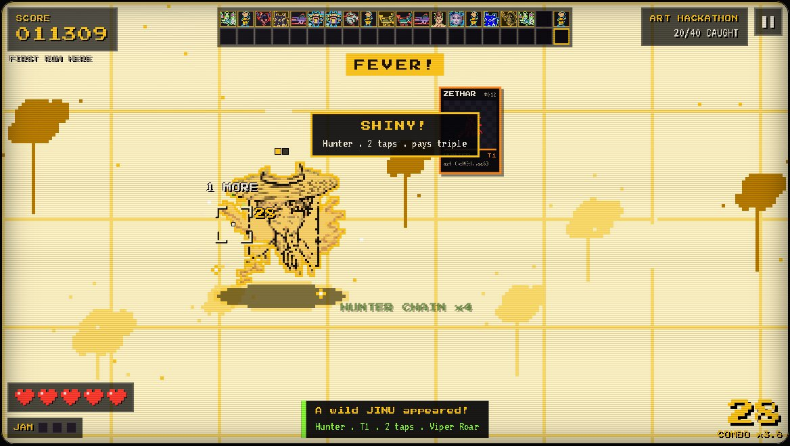
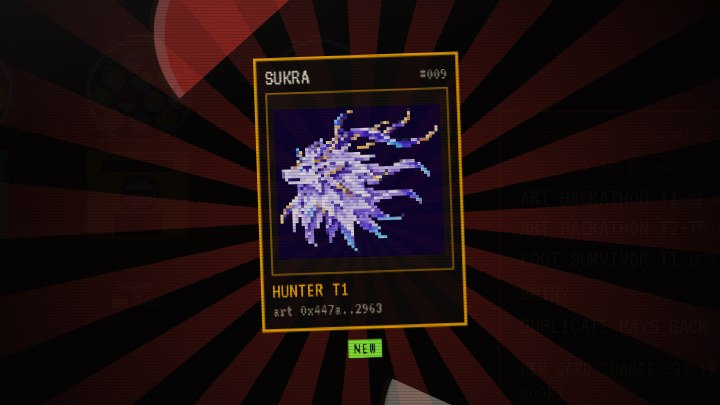
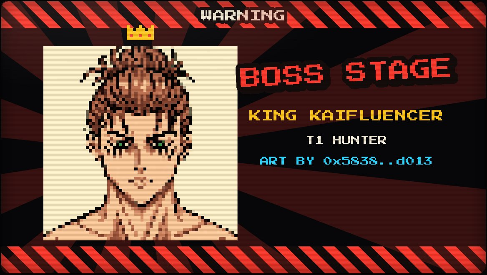
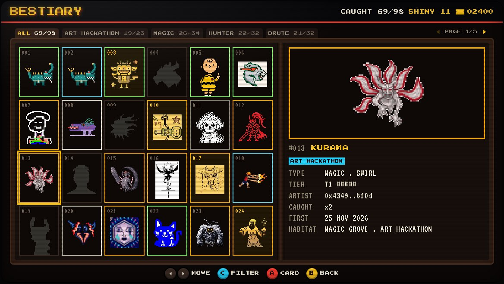
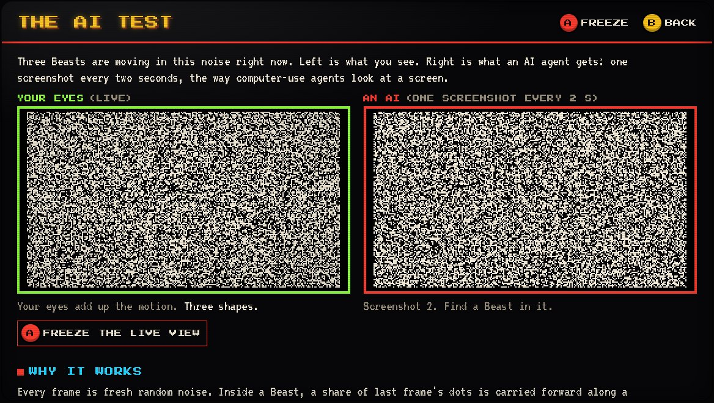
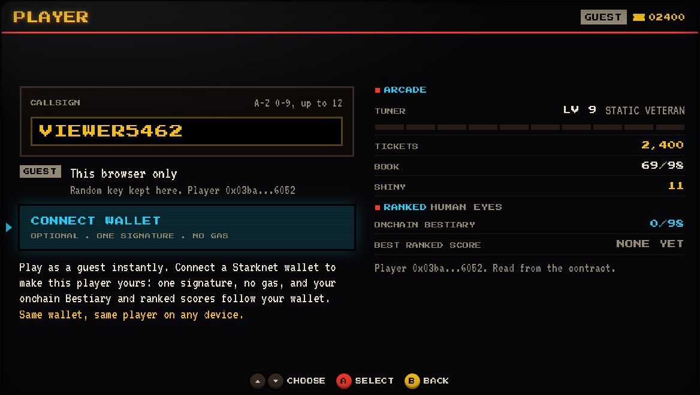

# BEAST ARCADE

<p align="center">
  
</p>

An arcade cabinet in your browser, full of small, fast Beast games. Every Beast inside is a real Beast NFT read from Starknet, the prizes go into a book you fill, and the one ranked cabinet is a game an AI can't see.

**Play it at [static-beasts.vercel.app](https://static-beasts.vercel.app).** No wallet, no sign-up: click the coin slot (or press Enter), pick a cabinet, and you're playing. There's also an [85-second video walkthrough](https://drive.google.com/file/d/1Kb8xPBlrbPFU8WMUQLQhBWDNDUMd2Mz_/view?usp=sharing).

Built for the Devcon 8 Beast NFT Vibeathon.

<p align="center">
  
</p>

## What's in the cabinet

**MICRO MAYHEM.** Four-second microgames, one after another, each a little faster than the last. Catch the Beast. Counter its type. Win the duel. Spot the shiny. Every fifteen games a King shows up: a T1 Art Hackathon Beast with a health bar.

<p align="center">
  
  
</p>

**BEAST CATCH.** Pick a habitat and tap wild Beasts before they run off. Three misses in a row jam your signal, so spamming doesn't work. Every catch flips into a card for your book, and a run of the same type builds into FEVER.

**PRIZE COUNTER.** Every game pays tickets. Spend them at the basic, rare and legendary capsule machines; every capsule is a card.

<p align="center">
  
  
</p>

**BESTIARY.** The book you're filling: 98 species, each with its art, type, tier and artist. The ones you haven't met yet are "???".

**HUMAN EYES (ranked).** The one cabinet that counts onchain. Here the Beasts are drawn only as motion inside TV static. Watch it live and you see them move. Pause it and there's nothing there.

<p align="center">
  
  
</p>

**Controls.** Mouse or tap to hit. A, S, D (or J K L, or 1 2 3) are the three cabinet buttons, the arrow keys are the joystick, and Enter is START. On a phone, the cabinet's control panel turns into the touch controller.

## The Beasts are real

Every Beast comes from the Beasts V3 contracts on Starknet, the same ones behind beasts.app: its pixel art, type, tier, level, health and kill record. None of that is decoration. It decides how the games play:

| What the NFT says | What it does in the arcade |
| --- | --- |
| Pixel art | Every sprite, card and capsule prize. In HUMAN EYES, the shape hidden in the noise |
| Type (Magic, Hunter, Brute) | The Loot Survivor triangle in COUNTER!, DUEL! and the King fights; how a Beast moves in BEAST CATCH; same-type chains |
| Tier | Points, capsule rarity, and which Beasts can be Kings |
| Level, prefix, suffix | Loot Survivor names above level 24, and they change behaviour: Gale is fast, Shadow is faint, Bane costs two lives |
| Health | How many hits a catch takes |
| Shiny | A gold variant, 1 in 12, worth triple and collected separately |
| Adventurers Killed | Aggression: Beasts with more kills move faster and leave sooner |
| Species creator | The artist credit on every featured Beast |

## Art from the Art Hackathon

The stars of the arcade are the Art Hackathon species: Marika, Kurama, Sukra, Kaifluencer, Lucifer, Hollowknight, The Onchain Guardian, Jinu and the rest. They're the featured Beasts in the microgames, they have their own habitat in BEAST CATCH, they fill the rare and legendary capsules, and only they can be Kings. They're always shown in full colour with their creator's credit. The 75 Loot Survivor originals fill out the rest of the book.

We also drew one of our own: **THE STATIC**, species 10091, registered on Beasts V3. You can [see it on beasts.app](https://beasts.app/#/beast/10091).

## Why it's on Starknet

A leaderboard is only worth something if nobody can fake a score and bots can't farm it. That's what the chain gives the ranked cabinet:

1. **Tapes are committed before anyone plays.** Each day the game contract stores one Merkle root covering 4,096 secret tape seeds. Which tape you get comes from a hash of your key and a nonce, so nobody can pick an easy one.
2. **Your browser only ever gets pixels.** The tape streams a few seconds at a time and never contains where the Beasts are.
3. **The contract replays your run.** Your strike log is signed with your player key. The relayer submits it with the revealed seed, and the contract checks the Merkle proof and the signature, then replays the whole run in Cairo (about 390k steps) before it records the score.
4. **Your catches go into an onchain Bestiary,** a per-player record that only verified runs can fill.
5. **Kills land on the NFT.** When a Beast takes your last life, its notoriety goes up and it plays more aggressively on future tapes. For THE STATIC, the Beasts V3 registry trusts our contract as its kill verifier, so those kills are written onto the NFT itself with `add_kill`.

The rules are written twice, in TypeScript (what you play) and in Cairo (what verifies), and 63 generated test vectors keep the two identical.

**Your player.** You start as a guest right away: a player key is made in your browser and a relayer pays the gas. To keep your player across devices, open PLAYER from the game select and connect a Starknet wallet (Ready or Braavos). It asks for one signature and costs no gas, and the same wallet gives you the same player anywhere.

<p align="center">
  
  
</p>

## Why an AI can't play it

- Everything happens in real time. Agents that look at a screenshot every second or two are too slow, and MICRO MAYHEM changes the rules every four seconds.
- In HUMAN EYES (and the HUMAN EYES! microgame), a Beast is a patch of noise that moves together. Pixels are only ever moved, never copied, so any single frame looks the same everywhere. A classifier given one frame scores 0.499 AUC, a coin flip, and frames a second apart share nothing. Your eyes add motion up over about a tenth of a second, which is exactly where the Beasts live.
- Blind clicking doesn't work either: three misses in a row jam the signal and cost a life.

The honest limit: a custom vision system reading every frame at full speed could compute the motion. Screenshot-driven agents, and anyone who pauses, see static.

## Run it yourself

```sh
npm install
npm run dev                     # every cabinet works offline; ranked play needs .env.local (see .env.example)
npm test                        # 269 tests: rules, renderer, arcade, microgames, tapes, accounts
npm run leak                    # single-frame and motion leak tests for the noise
cd contracts && snforge test    # 189 Cairo tests, including the parity vectors
```

| Where | What |
| --- | --- |
| `src/arcade/` | The cabinet, attract mode, game select, controls, tickets, capsule machine |
| `src/micro/` | MICRO MAYHEM and its microgames |
| `src/game/`, `src/ui/` | BEAST CATCH, the Bestiary, the PLAYER card and the other screens |
| `src/sim/`, `src/render/` | The rules shared with Cairo, and the noise renderer |
| `src/chain/` | Guest and wallet player keys, contract reads |
| `src/broadcast/`, `server/`, `api/` | Ranked tapes, Merkle commitments and the relayer (Vercel functions) |
| `contracts/` | The Cairo game contract and its tests |
| `scripts/` | Beast data pipeline, THE STATIC, test vectors, leak test, visual QA |

**Onchain, on Starknet Sepolia**

- Game contract: [`0x05a444ac0d273954ee12c0b487346189eb27fa96e3d445cf29a73b557971f2e1`](https://sepolia.voyager.online/contract/0x05a444ac0d273954ee12c0b487346189eb27fa96e3d445cf29a73b557971f2e1)
- Beasts V3 NFT: `0x2e2f3e29a04f92c2b4e8b91fa846d521aea2a682e490bdf46f18da6d0a8bbe1`
- Beasts V3 registry: `0x7f6883b4f901ce25aff2b10c876db8dfff68e61ba93102354816519e7fe1f`
- THE STATIC: species 10091

**A note on flicker.** HUMAN EYES is flickering noise. If that bothers you, switch CALM on in the operator row of the game select: lower contrast, half the frame rate.

## Credits

The Beast art belongs to the Beast NFT Art Hackathon artists, each credited in the game by their creator address, and to the original Loot Survivor Beasts. Beast data and art are read from the Beasts V3 contracts on Starknet. Fonts: Press Start 2P and VT323, both under the SIL Open Font License.
